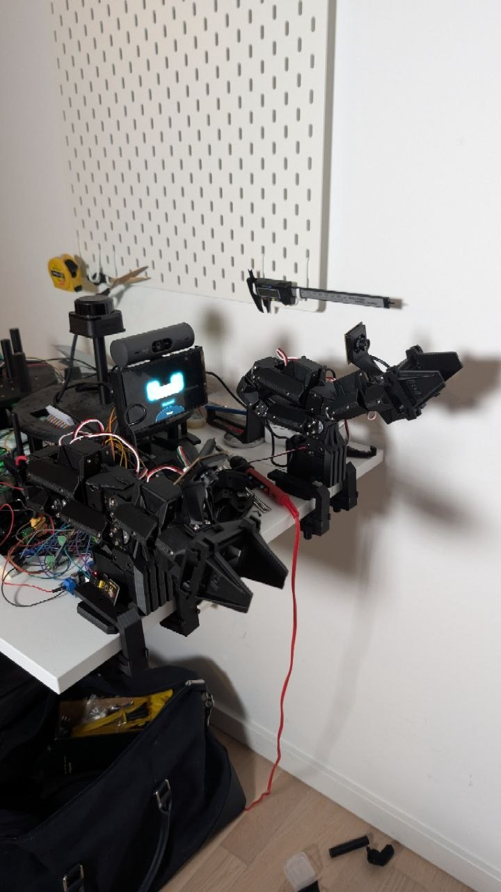

# 028 — Both arms on the servo bus: board modes, factory IDs, and the first moves

| | |
|---|---|
| **Date** | 2026-10-15 |
| **Type** | Bring-up — two ElRobot follower arms through the Teensy |
| **Status** | ✅ All 16 servos answer with unique IDs (left 1–8, right 11–18) · ✅ Read-only bus tooling · ✅ Both arms on the control panel · 🔄 Calibration (centre + range) and per-arm strength still to do |
| **Severity** | Medium — the arms were unaddressable as delivered, and the first moves strained two joints |

---



*History note, 2026-10-15: the evening both arms first answered with unique
IDs and moved from the control panel.*

## Context

Two ElRobot follower arms (8× STS3215 12 V each) are chained servo to servo.
One Waveshare **Bus Servo Adapter (A)** feeds them. It is driven from the
Teensy's `Serial7`, not over USB, so every motor sits behind the Teensy.

```
Teensy pin 29 (TX7) ── board TX        (Waveshare: "RX-RX, TX-TX")
Teensy pin 28 (RX7) ── board RX
Teensy GND ─────────── board GND       (signal reference only)
12 V ──[fuse]──────── board DC in      (never near a Teensy pin)
board servo ports ──► left chain, right chain
```

`Serial7` was chosen to leave every other pin plan intact:

- **The future encoder pins stay free.** The drive motors need four
  quadrature inputs from the XBAR-capable set 0, 1, 5, 7, 8, 30, 31, 33.
- **Pins already in use:** 2/3 (neck), 4 (LED strip) and 15 (light sensor).
- **`Serial3` is out,** because its RX pin is the light sensor's pin 15.

## First, a restart and a dead light sensor

During the wiring, the Teensy's LED went dark.

- **The Teensy was fine.** It had **restarted**: its USB device number
  changed (8 → 59), and its console showed a fresh `BOOT` and reconnected to
  micro-ROS.
- **A dark LED is normal after a boot.** The firmware blinks it only while it
  waits for the agent, then leaves it as it was.
- **The light sensor really had stopped.** A1 read **2–6**, against 529 (dark)
  to 1400 (bright) when it was calibrated. Its own LED was off: no 3.3 V
  reached the module. Reseating its jumper wires brought it back (≈2400 in a
  lit room).
- **Side effect:** while the sensor read 0, the strip's auto mode drove the
  LEDs to full (4095), because it took the room to be dark.

The cause was never pinned down. A brief short on the 3.3 V rail during
wiring fits both the restart and the loose module. **A 12 V touch on any
Teensy pin would not have been a restart.** Keep the board's supply away from
the Teensy.

## The board has two modes, and the scan proved which was set

The Bus Servo Adapter (A) has a 3×2 header with two yellow jumper caps:

| Caps on | Silkscreen | The servo bus is driven by |
|---|---|---|
| The two rows nearest the USB-C | **B** — USB → SERVO | the board's own USB chip; **the UART header is cut off** |
| The two rows by the TX/RX/GND header | **A** — UART → SERVO | the UART header, i.e. the Teensy |

Each cap joins the shared middle row to one end, so "A to B" is a misreading.
The scan's byte counter told the states apart:

| Jumpers | Bytes received during a full scan |
|---|---|
| on B | **0** |
| removed | **0** |
| on A | replies, with valid checksums |

## Read-only tooling first

The firmware got console commands that cannot move anything:

- **`BUS SCAN [port]`** sends only **PING (0x01)** and **READ (0x02)**, never
  to the broadcast ID. It reports each servo's model, position, voltage,
  temperature and torque state. A summary line counts **every byte received**
  (`rx_bytes`), which separates "nothing wired" from "no servo answering".
- **`BUS READ <id> <addr> <len>`** dumps one READ's raw reply.
- **The serial port opens on the first command, not at boot,** so nothing
  drives pins 28/29 until asked to.

`teensy_microros/console.py` sends one command and prints only the matching
reply lines.

## The servos were all still ID 1

The first scan with jumpers on A showed ID 1 answering a ping, IDs 2–252
silent, and every **read** of ID 1 failing. The raw replies explained it:

| Asked ID 1 for… | Reply |
|---|---|
| its ID | clean: `FF FF 01 03 00 01 FA` |
| its model / position | garbage: `01 40 00`, `00 AF 00 FD FF`, now and then a clean one |

A whole chain still had the factory ID 1. Identical replies (a ping, or "my
ID is 1") overlap into one valid packet. Different replies (each servo's own
position) collide. **That pattern points to duplicate IDs, not to noise from
a bad contact.** Noise would corrupt both kinds of question equally.

**No software route separates servos that share an ID.**

- Every write addressed to ID 1 is obeyed by all of them, including "change
  your ID".
- The STS3215 has no unique serial number to target one servo by.
- Turning a joint by hand changes what a servo would *say*, not which
  commands it *obeys*.

ElRobot's manual sets IDs before assembly for this reason.

## Assigning IDs on an assembled arm

The arms stay assembled. Each of the seven links in a chain has to be
unplugged once, in order from the base, so that a single ID-1 servo sits on
the board's side of the cut:

| Step | Plug back | Unplug | ID-1 servos left on the bus | Set |
|---|---|---|---|---|
| 1 | — | S1–S2 | S1 | 1 → 9 (temporary, left arm only) |
| 2 | S1–S2 | S2–S3 | S2 | 1 → 2 |
| … | … | … | … | … |
| 7 | S6–S7 | S7–S8 | S7 | 1 → 7 |
| 8 | S7–S8 | — | S8 | 1 → 8, then 9 → 1 |

The right arm went to **11–18** with the left arm unplugged. No temporary ID
was needed, because 11–18 cannot clash with an unassigned servo.

**`BUS SETID <from> <to>` is the only write the bus tooling has.**

- **It refuses unless exactly one servo answers at `from`.** It needs five
  clean position reads in a row.
- **It refuses if anything answers at `to`.**
- **It touches nothing but the EEPROM lock (55) and the ID register (5).**
- **It reads the ID back,** and checks the old ID has gone silent.

All 16 assignments returned `ok` on the first try. Final scan with both arms
on the bus: IDs **1–8 and 11–18**, all model **777** (STS3215), at
12.4–12.8 V.

## Both arms on the control panel

Each arm has a panel card: its gripper camera, **Enable torque** /
**Release**, a **Speed** slider, and eight joint sliders (0–4095). They are
backed by the commands `ARM <L|R> STATE | TORQUE ON | TORQUE OFF | SPEED <n> |
MOVE <joint> <pos>`. The guard rails:

- **MOVE is refused while that arm's torque is off.**
- **TORQUE ON writes each joint's present position as its goal before
  enabling it,** so switching on does not move anything.
- **Torque is capped at 300/1000.** That is ElRobot's own value while it
  explores a joint's range.
- **Speed starts at 400 steps/s (≈35 °/s).** The slider goes up to 3000
  (≈264 °/s), close to the servo's 12 V maximum.
- **The routes sit behind the same password guard as the cameras,** not the
  looser session check the neck uses.
- **STATE reports torque as the servos read it back.** A firmware flag
  forgets after a reflash, while the servos keep holding: the first version
  showed "off" for an arm that was still holding.

Measured end to end, a state read or a move takes **8–10 ms**. "Super slow"
was the 35 °/s starting speed, not latency.

## The first moves strained J3, J4 and J6 (right arm)

After Enable, those joints pushed toward a position they were not at. Their
registers, read with `BUS READ`:

| | J3 (13) | J4 (14) | J6 (16) |
|---|---|---|---|
| Goal → present | 2888 → 2884 | 2152 → 2131 | **3975 → 504** |
| Load | 4 % | 8 % | **30 %** (the cap) |
| Angle limits / max torque / P·D·I | 0–4095 / 1000 / 32·32·0 | same | same |
| Offset / mode | 85 / position | 85 / position | 85 / position |

Two causes, compounding:

1. **Gravity beats a 30 % cap.** J6 was pushing at exactly its limit and
   still sagged. J3 and J4 strained the same way, less.
2. **The 0/4095 seam.** The servo's position mode does not wrap. A joint
   sitting near 0 that sags a few steps across the seam has its goal suddenly
   a full turn away, and it drives the long way round into its mechanical
   stop. J6's goal of 3975 against a present position of 504 is that state.

Joints parked near the seam today: left J5 (4073), J6 (129), J7 (99) and
J8 (3944); right J5 (≈60).

## Also fixed

- **The `Makefile` on the robot was ahead of the repo.** It now carries the
  working flash path for Dual Serial:
  - stop the agent, which holds the port open
  - open the console at **134 baud**, the Teensy core's own bootloader trigger
  - wait for HalfKay, then `teensy_loader_cli -w`

  The old `-s` soft reboot needs an HID interface that Dual Serial does not
  have.
- **Contention on the console.** While an arm card is open, it polls through
  `teensy.py`, which flushes the console's input before every command. That
  silently ate replies meant for a second reader: one ID change's
  confirmation went missing. The servo was fine. The cards must be closed
  while scanning.

## Next

1. **Calibration, both arms.** Pose each joint mid-travel and store that as
   2048: Feetech's mid-point calibration writes 128 to the torque-enable
   register. That moves every seam to the far side of the joint's range.
   Then record each joint's real min/max by hand, and write them as the
   servo's angle limits. The sliders become each joint's real range.
2. **A per-arm Strength control** in place of the fixed 30 %: probably
   50–70 % for the joints that carry the arm (J2–J4).
3. **P gain 16.** ElRobot uses it against holding jitter; the factory value
   is 32.

## Takeaways

1. **Count every byte before blaming the servos.** `rx_bytes=0` pointed at the
   jumper, not the IDs, in one line.
2. **Clean pings with garbled reads mean duplicate IDs.** Identical answers
   overlap cleanly; different answers collide. Noise would not care which
   question was asked.
3. **Set bus-servo IDs before assembly.** Afterwards each link has to be
   unplugged once. Software cannot tell same-ID servos apart.
4. **"Enable" must hold, not move.** Goal = present comes before torque. Even
   then, a too-weak cap and an uncalibrated seam make a correct Enable look
   like it moved the arm.
5. **Report state from the hardware, not from a flag.** The servos outlive the
   firmware's memory of them.
