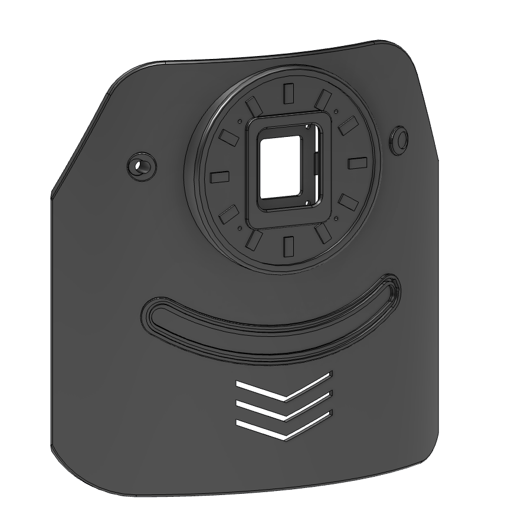
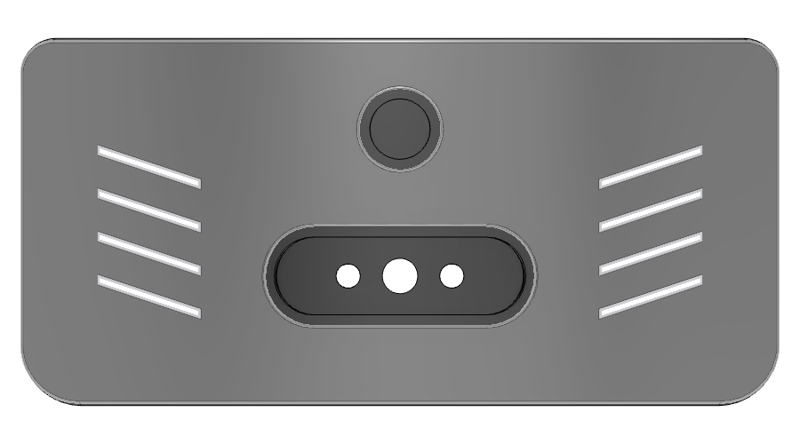

# 030 — Front and back covers, and the cable plan

| | |
|---|---|
| **Date** | 2026-10-16 (open) |
| **Type** | Design decision — the two printed covers, and how every cable gets between layers |
| **Status** | ✅ `front-cover-v1` and `back-cover-v1` modelled, saved and linked in the preview, with no clashes · ✅ Cable trunks, insert holes and the speaker grille cut in the floors · 🔄 `3rd-floor-v2` won't save from a script: press Cmd+S on it · 🔄 Print-test coupons before the full covers |
| **Severity** | Low — design work, nothing printed yet |

---

## Context

Follow-on from [029](029-2026-10-16-arm-mounts-on-the-first-layer.md), which
ended with concept covers (plain bodies) and a rough wiring list. The user asked
for:

- real covers, "more artistic" than the concept: the front an Iron Man chest,
  the back with the charge dock
- the light strip to go in easily
- **a cable strategy.** The concept had none worth the name.

During the work the user sent four photos and one answer:

- **KA009** is the light-strip variant they have.
- the back of the 1.69" display
- the mic array: **a ring, not a disc.** The concept's 12 through-slots matched
  nothing on the real board.
- the hole spacing on the speaker and on the USB hub

## Parts data used

| Part | Numbers | Source |
|---|---|---|
| Light strip KA009 | filament 300 mm, H 1 mm; driver board 13.7 × 9.9 mm; 220 mA at 5 V | vendor table (user) |
| 1.69" LCD (Waveshare module) | PCB 31.5 × 39, M2 on 24.3 × 31.8; active area 27.97 × 32.63, 1.10 below the glass top; 3.4 / 5.9 / 7.1 mm deep (PCB back / standoffs / connector) | Waveshare 2D drawing |
| reSpeaker mic ring | OD 72.5, ID 52.5, 1.51 thick; mic holes Ø1.0 at (±22, ±22); 3× Ø3.3 at r 31.25; bottom-port IM69D130 | Seeed STEP + photos |
| Speaker | M3 on a 43.4 mm square | measured by the user |
| Yahboom hub YB-ER001 | M3 on 58.2 × 50.2 | measured by the user |
| Pogo pins (2×) | Ø5.5 body, 5 A | inventory |
| DC-022B jack | Ø8 panel hole | inventory |

⚠️ **The inventory said "2.2 mm" for the strip.** The KA009 drawing says 1 mm.
The groove is cut for 1 mm. Measure the filament with calipers.

## Front cover — `front-cover-v1`

The shell is a 2.4 mm arc. It spans ±44°, at r 125.6 inside (the floors are
r 125). It runs from 8 mm below the deck top to the 3rd floor top (y −8 → 171).
The cover is modelled in place, in preview coordinates: y up, front = +z.

### The face, top to bottom

- **Eyes** at (±58.5, 128): raised Ø12 bosses with a recessed Ø7 iris.
  - **Left eye (−x):** the light sensor. A Ø5.2 hole, plus a sleeve inside.
    Push the photoresistor head in and add a dab of hot glue.
  - **Right eye:** decoration, and blind. Drill it out if it's ever needed.
- **Arc reactor (heart)** at (0, 124), Ø86:
  - a recessed bowl with 12 raised "coil" pads, every 30°
  - the display behind a bevelled window in a raised frame
  - **4 Ø1.6 mic ports**, and nothing else goes through. That replaces the
    12 slots.
- **Mouth:** a curved outline, 12 mm tall, on an arc of R106 with a ±30° span.
  - **Lip:** a raised ring, 1.4 mm high and 4.4 mm wide.
  - **Inside the lip:** recessed 0.8 mm, so it reads dark.
  - **Groove:** in the lip, 1.3 wide × 1.4 deep, for the 1 mm filament.
- **Chevrons:** three nested V vents, cut through, above the deck front.
- **Tabs:** 3 along the bottom edge (0°, ±25°), each taking an M3 down into a
  deck insert at r 119. **Replaced in log 031:** the 0° screw could not be
  reached, so both covers now use radial rivet screws into the floor edges.

### The light: why a loop, and how it goes in

**Why a loop:**
- The strip is 300 mm long and can't be cut.
- A smile of 90 mm would leave 210 mm coiled behind the cover.
- So the filament **outlines the whole mouth instead.**

**The numbers:**

| Item | Length |
|---|---|
| Outline, as drawn | 260 mm |
| Lead from the board to the groove | ~15 mm |
| Tail tucked back in | ~25 mm |

The ends of the mouth are R6 semicircles. That is the tightest bend.

**Fitting it, step by step:**
1. Slide the driver board into its cradle inside the cover, behind the right
   end of the mouth. The open side faces the hole.
2. Feed the filament out through the 1.5 × 4.5 slot at the right tip.
3. Press it into the groove all the way round.
4. Push the last ~25 mm back into the same slot.

### Display mount (z-stack, front face of the frame = 131)

| z | What |
|---|---|
| 131 → 129.6 | front lip with a 0.8 bevelled window (active area + 0.35 each side) |
| 129.6 → 126.2 | glass and PCB, in a 31.9 × 39.4 pocket |
| 126.2 → 123.7 | the module's brass standoffs |
| 123.7 → 121.7 | **printed retainer** (2 g, separate body in the same file) |

- **Retainer screws:** 4× M2×4 into the standoffs, and 2× M2×6 into two posts.
- **Preload:** the posts stop 0.2 mm short. Tightening them presses the glass
  into the lip.
- **Why from behind:** the glass covers the holes, so there is no way to fix
  the module from the front.

### Mic ring mount

- **Cup:** a Ø74 cup behind the reactor. The ring's plain face sits at
  z 125.4, which leaves **4 mm of plastic in front of the mics.**
- **Port resonance:** a 4 mm port resonates at c/4L ≈ 21 kHz. That is well
  above the 8 kHz the XVF3800 uses. The old solid boss would have made an
  11 mm tube, and 11 mm resonates at 7.5 kHz, inside the band.
- **Screws:** 3× M3 self-tap pilots behind three of the coil pads, at 12, 4
  and 8 o'clock, matching the photo.
- **FPC:** a notch at the bottom of the cup.
- **The display fits inside the ring's opening.** Its diagonal is 50.2 and the
  ring ID is 52.5, so the display cable goes straight back through the middle.
- **Fit between the floors:** 0.75 mm above the 2nd floor (top at y 87) and
  0.75 mm below the 3rd (underside at y 161).
- **Floor bands:** where the floors are, the cup's back edge is trimmed to
  r ≥ 125.5. Before the trim it ran 7 mm into both floor edges.

## Back cover — `back-cover-v1`

- **Size:** same shell, from y −8 up to the 2nd-floor underside (77). The
  antenna brackets above it reach r 140.
- **Why the ports are in the middle:**
  - the BMS holder's corners reach r 121
  - the hex posts sit at x 51–74
  - so a jack body (~14 mm deep) fits only at the centre
- **Charge dock** at y 22. A raised stadium lip in the same style as the
  mouth holds **pogo – DC jack – pogo** (x −12 / 0 / +12).
  - The pins sit in Ø5.6 × 10 mm sleeves. Slide each pin to the protrusion you
    want, then glue it.
  - Clearance to the BMS: 5 mm behind the sleeves, 1.8 mm behind the jack.
- **Light dial** at y 56: a Ø20 boss with a Ø14 knob seat and a Ø7.2 pot hole.
- **Gills:** 4 + 4 slanted slots on the sides.
- **Tabs:**
  - one onto the deck at 180°
  - two up into the 2nd floor at 165° and 195°
  - Inserts at 150° and similar would hit the hex posts or the BMS.
- **Weight:** about 49 g in PLA. The front is about 119 g.

## Clash check

- **Pairs checked:** each cover was checked with a boolean intersection against
  every body whose bounding box overlaps it. That was 21 pairs.
- **What it covered:** floors, posts, Teensy and breakout, separators, core
  board, BMS, copper posts and plate.
- **Result:** all 21 came out at 0 mm³.
- **Is the method sound:** the same check, run on the real front cover against
  the hidden concept cover, gives 84 730 mm³. So it does detect overlaps.

## The cable plan

### Rules

1. **Each cable goes through a named trunk.** Nothing goes through a hole
   meant for something else.
2. **Power and signal climb on opposite sides at the front.** The mics, the
   LDR and USB stay away from the 12 V and 5 V runs.
3. **Short runs, same floor, where possible:**
   - the display goes to the XIAO on the core board
   - the lidar drops straight onto the Jetson
   - the antennas stay on the 2nd floor
4. **The pogo pins are exposed.** They must never be live from the jack.
   - Use the DC-022B's **switch pin**, which breaks when a plug is in, to cut
     the pogo path.
   - Better still, add one Schottky per input into the XL4015.

### Trunks (cut in the models)

| Trunk | Where (preview x, z) | Size | Carries |
|---|---|---|---|
| **T1L** 1st→2nd, front left | (−37, 110) | 30 × 10 | **signal:** Teensy USB → Jetson, LDR (3 wires), any spare I/O |
| **T1R** 1st→2nd, front right | (37, 110) | 30 × 10 | **power:** XVF3800 12 V, neck servos 5 V + signal |
| **T3L / T3R** 1st→2nd, back sides | (±45, −75) | 10 × 30 | arm-camera USB → hub, hub 12 V, UPS input |
| **Ø17** 2nd→3rd, front (existing) | neck | Ø17 | screen HDMI + touch USB, Brio USB, neck servos |
| **Lidar slot** 3rd floor | (0, −36), behind the holder post | 14 × 9 | C1 USB → Jetson (USB-A plug passes) |
| **Pod slots** through the deck | (±31, 88) front, (−58, −110) back | 12 × 6 | HC-SR04P leads, up from under the deck |
| **Sides** (open, no hole) | between the floors at the arm notches | — | arm bus + 12 V and the camera USB, from each arm base |

### Connections

| From | To | Route |
|---|---|---|
| BMS pack (back) | fuse block → IBT-2 ×2, servo adapter, MINI560, LM2596 | along the deck, 1st floor |
| BMS pack | XVF3800 12 V terminal | deck → **T1R** |
| BMS pack | hub 12 V, UPS input | deck → **T3** |
| DC jack + pogo (back cover) | XL4015 in (right-outer holder) → Schottky → pack | right side of the deck |
| Light dial (back cover) | Teensy analog | along the deck, twisted, away from the motor leads |
| LDR (front cover, left eye) | Teensy A1 | down inside the cover → **T1L** |
| KA009 board (inside the mouth) | MINI560 → D4184 (left-inner holder) | along the front of the deck, ~150 mm |
| Mic ring FPC | core board (2nd floor front) | flat on the 2nd floor top, ~20 mm |
| 1.69" display | XIAO on the core board | back through the ring opening, then down |
| Speaker (under the 3rd floor, back) | core board amp JST | under the 3rd floor, over the Jetson |
| HC-SR04P ×3 | Teensy | under the deck → pod slots |
| IBT-2 outputs | drive motors | down through the motor pockets |
| Servo adapter | arms (bus + 12 V) | out the sides, into each arm base |
| Arm cameras | hub | down each arm, in at the side → **T3L/T3R** |
| Teensy USB | Jetson | **T1L** |
| C1 | Jetson | **lidar slot** |
| Screen, Brio, neck | Jetson / hub / LM2596 | **Ø17** → **T1** |

### Inserts and screws to buy

| Where | Insert | Screw |
|---|---|---|
| Deck: cover tabs (4) | M3 heat-set, hole Ø4.2 × 6 | M3×8 |
| 2nd floor: back-cover tabs (2), from below | M3, Ø4.2 × 6 | M3×8 |
| 2nd floor: hub (4) | M3, Ø4.2 × 6 | 8 mm M3 standoffs |
| 3rd floor: speaker (4), from below | M3, Ø4.2 × 6 | M3×6 through the frame |
| Front cover: display retainer | — | 4× M2×4, 2× M2×6 self-tap |
| Front cover: mic ring | — | 3× M3×6 self-tap |
| 3rd floor: grille cap | — | 3 printed pins press in |

## What changed in each file

- **`front-cover-v1`, `back-cover-v1`:** new Part files, in place, linked in
  the preview. The concept covers are hidden, not deleted.
- **`1st-layer-v4`:**
  - 4 cover-tab insert holes
  - 3 ultrasonic wire slots
- **`2nd-floor-v2`:**
  - T1L/T1R and T3L/T3R
  - 2 back-cover insert holes from below
  - 4 hub inserts
- **`3rd-floor-v2`:**
  - lidar slot
  - 4 speaker inserts
  - a grille of 55 × Ø3 holes
  - a **grille cap**, as its own body. It has 46 × Ø2.2 holes offset half a
    cell from the grille, over a 2 mm gap, so nothing falls straight
    through. It is held by 3 pins.
  - ⚠️ **Not saved.** `saveAs` returns True from the API and nothing reaches
    the cloud. A local backup is
    `3rd-floor-v2_backup.f3d` (scratchpad `recovery/`). **Cmd+S it.**
- **Preview:**
  - `Fit study` now has the real hub pattern and a 50 × 50 speaker
  - **Still to do:** swap the static 3rd-floor copy for the link once it is
    saved

## Wrong turns

- **The 12 reactor through-slots.** They were decoration that read as holes for
  a board that doesn't have them. The ring has 4 mics. Now 4 ports go through,
  and the decoration is raised pads.
- **The first smile groove was 2.6 mm, for "2.2 mm" from the inventory.** The
  KA009 is 1 mm, and it would have rattled in that groove. The smile was also
  one arc of 90 mm, for a strip of 300 mm.
- **The concept display pocket was open to the front and 4 mm deep.** The
  module needs 7.1 mm, and its holes are under the glass. The first version
  would have needed glue and shown a hole under the screen.
- **Emboss wraps; extrude projects.** Fusion's Emboss lays the sketch onto
  the curved face with the arc length kept. A straight cut lands at the
  projected x.
  - **What went wrong:** the first filament hole sat 1.9 mm outboard of its
    groove.
  - **The fix:** map the cut with x = R·sin(s/R).
- **The reactor cup cut into both floors.** The bounding-box view didn't show
  it. Comparing the y ranges of the floors with the cup did.
- **`save()` inside the same script as edits.** Right after `saveAs` the
  document isn't saved yet: the upload is asynchronous. `save()` then throws,
  and the throw rolls back the edits made in that script. Save in its own call.

## Next

1. **Cmd+S `3rd-floor-v2`.** Then link it in the preview and hide the static
   copy.
2. **Print coupons first:**
   - a 30 mm strip of the mouth lip with the groove: does the filament press
     in and stay?
   - the pogo sleeve
   - the LDR hole
   - the retainer posts
3. **Measure:**
   - the filament diameter
   - the DC-022B body length: the clearance to the BMS is 1.8 mm
   - the speaker depth
   - the hub board outline
   - the UPS (C) input connector
4. **Bench-test KA009 dimming** through the D4184. It is a constant-current
   board: check for flicker at 18 kHz.
5. **Holders:** the 4 vertical holders for the base boards as printable parts.

## Takeaways

- **Before you design a part around a board, look at the board.** One photo
  of the ring made the 12-slot reactor obviously wrong.
- **When a part can't be cut to length, design the shape around its length.**
- **A cable plan is a list of trunks, not a list of holes.** Name each
  pass-through and decide what goes in it: power on one side, signal on the
  other. Then the holes follow.
